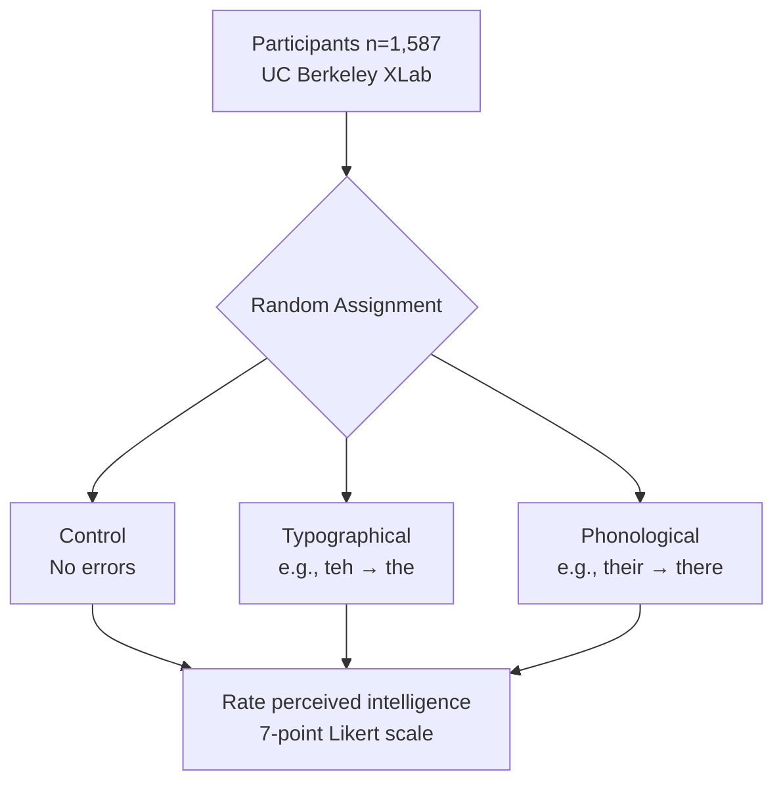

<div align="center">

# Do Grammatical Errors in Social Media Posts Affect the Perception of the Authors' Intelligence?

**A Randomized Controlled Trial**


[View Live Results](https://w241-final-project.azurewebsites.net/) · [Read the Paper](#abstract) · [Reproduce the Analysis](#reproduction)

</div>

---

## Key Findings

> **Both typographical and phonological errors significantly reduced perceived intelligence ratings (p < 0.001).**

| Treatment | Effect on Intelligence Rating | Significance |
|-----------|-------------------------------|--------------|
| Phonological errors (e.g., *their→there*) | **-1.57** points | p < 0.001 |
| Typographical errors (e.g., *teh→the*) | **-0.73** points | p < 0.001 |

**Bottom line:** Phonological errors are twice as damaging to perceived intelligence as simple typos. On a 7-point scale, a single phonological error costs you nearly a quarter of the entire range.

---

## Abstract

Command of language is among the most significant cognitive signals we encounter on social media. When employers screen candidates via social media—with 57% rejecting applicants for "poor communication skills" ([Driver, 2020](https://www.businessnewsdaily.com/2377-social-media-hiring.html))—do grammatical errors unfairly bias perceptions of intelligence?

We conducted a randomized controlled trial (n=1,587) through UC Berkeley's XLab, exposing participants to social media posts containing either **no errors (control)**, **typographical errors**, or **phonological errors**. Participants rated perceived author intelligence on a 7-point Likert scale.

Both error types significantly reduced perceived intelligence, but phonological errors (e.g., *your/you're* confusion) proved twice as damaging as typographical errors (e.g., transposed letters). These findings suggest that certain grammatical mistakes carry disproportionate social costs in digital communication.

**Keywords:** causal inference, randomized controlled trial, perceived intelligence, social media, grammatical errors

---

## Methods

### Experimental Design



### Treatment Conditions

- **Control:** Six social media posts with correct grammar
- **Typographical:** Same posts with typos (transposed letters, doubled characters)
- **Phonological:** Same posts with sound-based errors (*their/there*, *your/you're*)

### Statistical Approach

Linear regression with robust standard errors (HC1), controlling for post characteristics and demographics. Covariate balance verified via F-tests.

---

## Repository Structure

```
typos_field_experiment/
├── R-analysis/           # Statistical analysis & causal inference
│   ├── final_project.Rmd # Main analysis (treatment effects, robustness checks)
│   ├── pilot_study.Rmd   # Pilot study & power analysis
│   └── *.csv             # Anonymized experimental data
├── visualizations/       # Python visualization layer
│   └── plot_utils.py     # UC Berkeley color theme for Altair
├── pelican-site/         # Static site generator
│   └── content/          # Markdown content for live site
└── static-site/          # Production build (Azure deployment)
```

### Tech Stack

| Layer | Tools |
|-------|-------|
| **Analysis** | R 4.0.4 · tidyverse · data.table · sandwich · lmtest |
| **Visualization** | Python 3.8 · Altair · matplotlib · seaborn |
| **Deployment** | Pelican · Azure App Service |

---

## Reproduction

### Prerequisites

- [R 4.0.4+](https://cran.r-project.org/) with packages: `tidyverse`, `data.table`, `sandwich`, `lmtest`, `cobalt`
- [Python 3.8+](https://www.anaconda.com/products/individual) (optional, for visualizations)

### Quick Start

```bash
# Clone the repository
git clone https://github.com/cbenge509/typos_field_experiment.git
cd typos_field_experiment

# Run the main analysis (R)
cd R-analysis
Rscript -e "rmarkdown::render('final_project.Rmd')"

# Optional: Set up Python environment for visualizations
conda create -n typos python=3.8.8
conda activate typos
pip install -r requirements.txt
```

### Outputs

- `final_project.pdf` — Full statistical report with regression tables
- `pilot_study.pdf` — Power analysis and pilot results

---

## Citation

If you use this work in your research, please cite:

```bibtex
@misc{benge2021typos,
  title={Do Grammatical Errors in Social Media Posts Affect the Perception of the Authors' Intelligence?},
  author={Benge, Cristopher and Jiang, Siduo and Fogarty, Andrew},
  year={2021},
  institution={UC Berkeley School of Information},
  note={W241 Experiments and Causal Inference}
}
```

## Authors

[Cristopher Benge](https://cbenge509.github.io/) · [Siduo (Stone) Jiang](https://www.linkedin.com/in/siduojiang/) · [Andrew Fogarty](http://seekinginference.com/)

UC Berkeley, Master of Information and Data Science
W241 Experiments and Causal Inference · Spring 2021
Instructor: [D. Alex Hughes, PhD](https://www.ischool.berkeley.edu/people/d-alex-hughes)

## License

[MIT](LICENSE)
